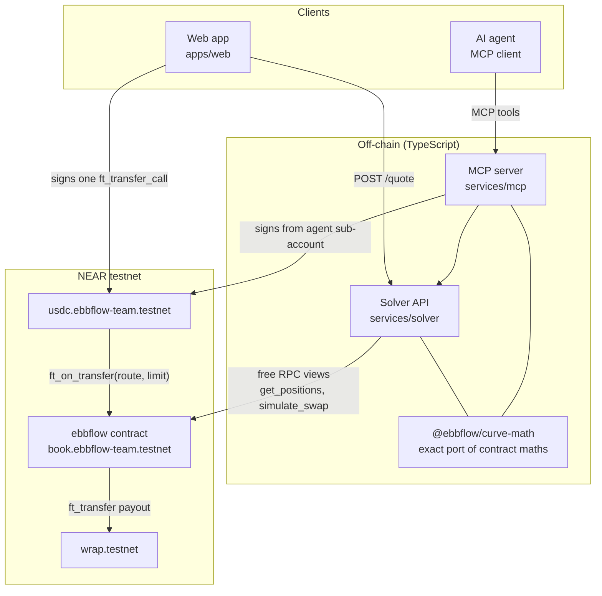
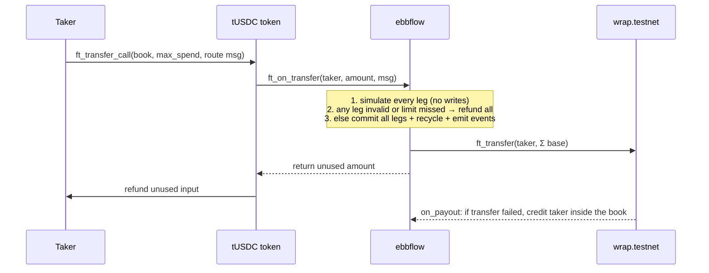

# Ebbflow

**Curve liquidity for NEAR.** On most order books an order is one price. On Ebbflow an order is a **curve across a price range**. One NEAR transaction fills a trade across many makers at once, **all or nothing**, and whatever a maker earns **automatically refills the other side** of their curve, so liquidity keeps quoting both ways with no bot. Traders use a web app; AI agents trade against the same book through an MCP server.

Built for **NEAR HACKATHON 2026** · Tracks: **Unstoppable DeFi** (primary), **Agent Economy** (secondary) · Live on **NEAR testnet**

| | |
|---|---|
| Order book contract | [`book.ebbflow-team.testnet`](https://testnet.nearblocks.io/address/book.ebbflow-team.testnet) |
| Test USDC (tUSDC) | [`usdc.ebbflow-team.testnet`](https://testnet.nearblocks.io/address/usdc.ebbflow-team.testnet) |
| wNEAR | `wrap.testnet` |
| Market 0 | wNEAR / tUSDC |

---

## Contents

- [Why](#why)
- [How it works](#how-it-works)
- [Seen on testnet](#seen-on-testnet)
- [Architecture](#architecture)
- [The curve maths](#the-curve-maths)
- [Web app](#web-app)
- [Atomic multi-maker settlement on NEAR](#atomic-multi-maker-settlement-on-near)
- [Custody model and its trade-off](#custody-model-and-its-trade-off)
- [AI agents (MCP)](#ai-agents-mcp)
- [Quick start](#quick-start)
- [Testing](#testing)
- [Repository layout](#repository-layout)
- [Contract reference](#contract-reference)
- [Known limitations](#known-limitations)
- [Roadmap](#roadmap)

---

## Why

| Model | Problem |
|---|---|
| **Order books** | Each order is a single price. Spreading liquidity across a range means posting many orders and running a bot to cancel and repost them. Proceeds sit idle until the maker acts. |
| **AMMs** | Liquidity is spread automatically, but the shape is a fixed formula and every LP shares one pool. Makers can't express their own view. |

Ebbflow gives each maker a **bounded, executable pricing curve** they shape themselves. The contract quotes and fills directly from it, and the maker can withdraw at any time.

## How it works

A maker sets, per side:

| Setting | Meaning |
|---|---|
| Inventory | wNEAR to sell (ask side) and/or tUSDC to buy with (bid side) |
| Start / end price | Where each side of the curve begins and stops |
| Alpha (0–3) | Shape: `0` spreads liquidity evenly; higher values bunch it near the current price |

Three mechanics:

1. **Curve pricing.** The more a taker takes from one maker, the further along the curve they move, so large size pays more. A maker is never emptied at one price.
2. **Multi-maker routing.** A solver splits each trade across up to 8 makers for the best total price; the contract settles every leg in one receipt.
3. **Inventory recycling.** What a maker receives on one side is added to the opposite side **without moving that side's price**, so the position keeps quoting both ways with no extra transaction.

> **A limit order is a special case.** If start price = end price the curve collapses to one point. Curves and limit orders run through exactly the same code path.

### Worked example (from the [PRD](PRD.md#78-worked-example-with-the-real-formula))

- **Priya** posts a curve: sell 400 wNEAR from $5.04 → $5.20, and buy wNEAR with 2,000 USDC from $4.96 → $4.80, alpha 1.
- **Arjun** posts a limit order: sell 100 wNEAR at exactly $5.06.
- **Rahul** buys 200 wNEAR. Taking everything from Priya would push her price to $5.08, above Arjun's $5.06, so the solver equalises marginal prices at **$5.06**: Priya ≈ 141.42 wNEAR, Arjun ≈ 58.58 wNEAR, **$1,010.11 total**. Rahul signs one transaction; unused input is refunded.
- **Recycling:** Priya's ~$713.70 proceeds land on her bid side, which grows 2,000 → 2,713.70 USDC while her best bid **stays at $4.96**. When the price dips she buys back cheaper than she sold, with no bot.

This exact scenario is a unit test in the contract (`prd_worked_example`) and in the solver.

## Seen on testnet

Every flow below ran against the deployed contract with demo accounts created by [`scripts/seed.sh`](scripts/seed.sh):

| Flow | Transaction |
|---|---|
| Rahul buys 2 wNEAR split across Priya (curve) + Arjun (limit) in one tx; unused input refunded; Priya's bid recycled | [`GSCcaAB5…`](https://testnet.nearblocks.io/txns/GSCcaAB5LgnyUfgvG5ZkL7JXaBS22E87Vitq7pdKjqoG) |
| An AI agent buys 0.5 wNEAR through the MCP server from its budgeted account | [`F8oXfbv5…`](https://testnet.nearblocks.io/txns/F8oXfbv5uj5zEjCWhXR6PWvUW34dT2okHUcmmhaK3yYT) |
| Rahul sells 0.5 wNEAR into Priya's bid; base recycles into her ask at an unchanged price | [`Atz29d5B…`](https://testnet.nearblocks.io/txns/Atz29d5BznogzbVt538HhRSUvV2hy1XHQ1wSkuD9X8YZ) |
| Stale route (maker closed first) → rejected with `E05_POSITION_NOT_FOUND`, full refund, no state change | [`8eBRp9cL…`](https://testnet.nearblocks.io/txns/8eBRp9cL8o63fQkAUSk9TWysN9Y9FirSciWz2i8xvbA4) |

Also verified live: close position, withdraw (full and partial), payout to an unregistered account credited inside the book, failed withdraw restored by callback, and pause blocking swaps but never withdrawals.

## Architecture



| Component | Tech | Responsibility |
|---|---|---|
| `apps/web` | Next.js 14, Tailwind, NEAR Wallet Selector | Landing page plus Trade, Make, Portfolio, Activity and Faucet |
| `contracts/ebbflow` | Rust, near-sdk 5.30 | Per-account balances, immutable curve positions, exact integer curve maths, atomic multi-leg swaps, recycling, NEP-297 events, quote/simulate views |
| `contracts/test-token` | Rust, near-contract-standards | tUSDC: 6-decimal NEP-141 with a public faucet |
| `packages/curve-math` | TypeScript (bigint) | Exact port of the contract maths, checked against 400 fixtures generated by the Rust code |
| `services/solver` | TypeScript, Hono | Stateless: reads positions over RPC, computes the optimal route, returns the exact transaction to sign |
| `services/mcp` | TypeScript, MCP SDK, near-api-js | Seven agent tools; signs swaps from a budget-capped sub-account |

## The curve maths

Prices are quote atomic units per one whole base token, scaled by `10^12`. Each side stores its remaining segment: current price `p_c`, end price `p_e`, remaining inventory `R` and integer `alpha ∈ {0,1,2,3}`, with `k = alpha + 1`. Taking a fraction `x` of the side's base capacity moves the marginal price along

```
ask (maker sells base):  p(x) = p_c + (p_e − p_c) · x^k      price rises
bid (maker buys base):   p(x) = p_c − (p_c − p_e) · x^k      price falls
```

and the quote for taking `Δ` base is the integral

```
quote(Δ) = Δ · [ p_c ± span · x^k / (k + 1) ]
```

- **Exact integer arithmetic.** Integer `alpha` means no fixed-point `pow`/`ln`. Intermediate products exceed `u128` (e.g. `400e24 × 5e18`), so all curve maths uses **U256** with checked operations.
- **Rounding always goes against the taker.** Cost rounds up, output rounds down, `x^k` rounds up at each step. Property tests assert a maker never fills below their pre-fill marginal price.
- **One leg per position per route.** For `alpha = 0` the maths is path-independent (50 + 50 = 100, tested). For `alpha > 0` the remaining segment is re-parameterised after each fill, so the contract allows each position at most once per route, and the solver prices with the identical maths.

Full derivation, rounding table and validation rules: [PRD §7](PRD.md#7-domain-model-and-curve-mathematics).

## Web app

[`apps/web`](apps/web/README.md) is the trader and maker UI. It is built with Next.js 14, TypeScript and Tailwind, and connects wallets through NEAR Wallet Selector (MyNearWallet, Meteor, HERE).

| Route | What it does |
|---|---|
| `/trade` | Per-maker depth chart, live solver quote, buy/sell (exact size, or a tUSDC budget for buys), slippage. Executes as **one** `ft_transfer_call` and shows the result as **Filled** or **Refunded** |
| `/make` | Ask/bid curve inputs, alpha slider, limit-order toggle, live curve preview and slice table. Deposit (and register), then publish |
| `/portfolio` | Wallet and book balances, withdraw, positions with fills and realised spread, close |
| `/activity` | Recent fills from the contract's on-chain ring buffer, with recycling badges |
| `/faucet` | Mint tUSDC, wrap NEAR into wNEAR, NEP-145 registration |

Quotes come from the solver, and the contract enforces the limit, so a stale quote in the UI can only ever cause a refund. Contract and market addresses are read from [`deployments/testnet.json`](deployments/testnet.json).

## Atomic multi-maker settlement on NEAR

NEAR cross-contract calls are asynchronous, so atomicity cannot come from chaining contracts. Ebbflow does **every fill inside one contract call**:



The swap message names each leg's exact base amount:

```json
{
  "action": "swap",
  "market_id": 0,
  "side": "buy_base",
  "legs": [
    { "position_id": "0", "base_amount": "141421356237309504880168872" },
    { "position_id": "1", "base_amount": "58578643762690495119831128" }
  ],
  "min_amount_out": "200000000000000000000000000"
}
```

- **The limit is enforced on-chain.** Buy: total cost must fit in the attached amount. Sell: output must reach `min_amount_out`. A stale or wrong solver quote can never produce a worse fill than the taker signed for; the worst case is a refund.
- **Simulate, then commit.** Rejected routes leave state untouched and emit `swap_rejected` with a reason code.
- **Funds are never lost.** If the payout fails (recipient not registered with the token), `on_payout` credits the amount inside the book, withdrawable later.
- **Bounded gas.** Routes are capped at 8 legs.

## Custody model and its trade-off

NEP-141 tokens have **no `approve`/`transferFrom`**, so makers can't keep funds in their own wallet and grant the book an allowance. Keeping maker balances inside one contract is what makes a multi-maker fill atomic on NEAR. We make up for that with strict rules:

- **Segregated balances** per account and token.
- **Only the account itself** can withdraw its balance or close its positions, at any time.
- **Curves are immutable** once published.
- **No admin path to user funds.** The owner can only add markets and pause *new* positions and swaps. Pause never blocks closing or withdrawing (tested on-chain).

Roadmap: per-maker vault sub-accounts (e.g. `book.priya.testnet`) with reserve-then-commit settlement for full self-custody.

## AI agents (MCP)

[`services/mcp`](services/mcp/README.md) exposes the book to any MCP client (Claude Code, Claude Desktop and others):

| Tool | |
|---|---|
| `list_markets` | Best bid/ask, positions, depth |
| `get_liquidity` | Per-maker curves (curve vs limit) and depth by price level |
| `get_quote` | Best route across up to 8 makers + the transaction to sign |
| `simulate_route` | Quote + dry run against the contract's `simulate_swap` view |
| `compare_liquidity` | Multi-maker route vs the single best maker for the same size |
| `execute_swap` | Checks limits → simulates → signs and sends; `dry_run` supported |
| `get_agent_balance` | NEAR, wallet and in-book balances, remaining daily limit |

**Budget model.** The agent signs only from its own sub-account, funded with a fixed amount, so **its maximum loss is that balance**. `ft_transfer_call` requires 1 yoctoNEAR attached, which function-call access keys can't do, so the agent holds a full-access key to that isolated account only, never to the parent. On top of that, `execute_swap` enforces per-trade and daily caps, always simulates first, and the contract enforces the price limit.

```bash
claude mcp add ebbflow -e AGENT_ACCOUNT_ID=you-agent.testnet -- node /path/to/repo/services/mcp/dist/index.js
# "Using ebbflow, how deep is the wNEAR book? Buy 0.5 wNEAR if the average price is under 5.10."
```

## Quick start

**Prerequisites:** Rust (`rustup`; the pinned 1.95 toolchain and nightly with `rust-src` for wasm), Node 20+, pnpm 9, [near-cli-rs](https://github.com/near/near-cli-rs), optionally `cargo install wasm-tools`.

```bash
# 1. Build + test
cargo test                      # contract unit + property tests
pnpm install && pnpm build
pnpm test                       # curve-math parity, solver, MCP

# 2. Build NEAR-compatible wasm into res/ (validated as MVP wasm)
./scripts/build.sh

# 3. Deploy your own copy to testnet (or use the live one above)
near account create-account sponsor-by-faucet-service you.testnet \
  autogenerate-new-keypair save-to-keychain network-config testnet create
MASTER_ACCOUNT=you.testnet ./scripts/deploy.sh    # writes deployments/testnet.json

# 4. Seed demo makers (Priya curve, Arjun limit order) and a taker
./scripts/seed.sh

# 5. Run the solver (reads deployments/testnet.json)
pnpm solver                                       # http://localhost:8787
curl -X POST localhost:8787/quote -H 'content-type: application/json' \
  -d '{"market_id":0,"side":"buy_base","base_amount":"1"}'

# 6. Run the web app (second terminal; needs the solver running)
pnpm web                                          # http://localhost:3100

# 7. Let an agent trade
AGENT_ACCOUNT_ID=you-agent.testnet pnpm --filter @ebbflow/mcp demo 0.5
```

### Solver API

| Endpoint | Returns |
|---|---|
| `GET /health` | RPC status and block height |
| `GET /markets` | Best bid/ask, positions, depth per market |
| `GET /markets/:id/curves?points=50` | Per-maker curve points and aggregated depth for charts |
| `GET /markets/:id/positions` | Raw positions |
| `POST /quote` | Route, average price, price impact, limits, warnings, and `tx`: the exact `ft_transfer_call` to sign (150 Tgas, 1 yoctoNEAR) |
| `POST /simulate` | Proxies the contract's `simulate_swap` view |

`/quote` accepts `base_amount` (exact size, buy or sell) or `quote_amount` (buy with a budget), plus `slippage_bps`, `taker` and `recipient`. Routing is marginal-price water-filling; each leg is then priced with the exact integer maths, so the quote matches settlement.

## Testing

| Suite | Count | What it covers |
|---|---|---|
| Contract unit tests (`cargo test`) | 37 | Curve maths for every alpha, limit orders, rounding direction, overflow at 24-decimal extremes, the PRD worked example, 2-maker route, stale-route refund, wrong token, duplicate/too many legs, min-out, pause, ownership, payout and withdraw callbacks, value conservation across mixed trades |
| Contract property tests (proptest) | 2 × 2,000 cases | Contract maths vs a reference model, always in the maker's favour, monotonic prices |
| Test token | 2 | Faucet mint and limit |
| `curve-math` parity | 402 | TypeScript port matches the Rust contract exactly on 400 generated cases (including errors) |
| Solver | 21 | PRD route, tx args, sells, 8-leg cap, liquidity errors, exact-in budgets, no-dust limit fills, optimality vs brute force on random books, HTTP API |
| MCP | 17 | Every tool, budget caps, dry run, failed simulation, refunds, MCP client↔server round trip |
| Web app | 21 | Transaction builders and the transaction-outcome parser (wallet signing itself needs a real wallet and is tested manually) |
| Sandbox integration ([`tests/integration`](tests/integration/tests/sandbox.rs)) | 5 | Real wasm on a local NEAR sandbox incl. 8-leg gas benchmark (needs `libssl-dev`: `cargo test -p integration-tests`) |

Regenerate the parity fixtures after changing contract maths: `EBBFLOW_WRITE_FIXTURES=1 cargo test -p ebbflow export_fixtures`.

## Repository layout

```
apps/web/             Next.js web app (trade, make, portfolio, activity, faucet)
contracts/
  ebbflow/src/        lib.rs (contract), curve.rs (maths), events.rs, tests.rs
  test-token/         tUSDC faucet token
packages/curve-math/  TypeScript port of the maths + Rust-generated fixtures
services/
  solver/             routing, quote builder, HTTP API (also a library)
  mcp/                MCP server, tools, agent demo
tests/integration/    near-workspaces sandbox tests
scripts/              build.sh, deploy.sh, seed.sh
res/                  deployed wasm (built by scripts/build.sh)
deployments/          testnet addresses
PRD.md                full product requirements and design
```

## Contract reference

**Change methods**

| Method | Notes |
|---|---|
| `ft_on_transfer(sender_id, amount, msg)` | `{"action":"deposit"}` or `{"action":"swap", …}`; unknown tokens and bad messages are refunded |
| `create_position(market_id, ask?, bid?)` | Attach 0.01 NEAR storage (refunded on close). Each side: `{amount, start_price, end_price, alpha}` |
| `close_position(position_id)` | Owner only, 1 yoctoNEAR |
| `withdraw(token_id, amount?)` | 1 yoctoNEAR; omit `amount` to withdraw everything |
| `storage_deposit(account_id?)` | One-off 0.01 NEAR registration (NEP-145) |
| `add_market`, `set_paused` | Owner only; cannot touch user funds |

**Views:** `get_markets`, `get_positions(market_id, from_index?, limit?)`, `get_position`, `get_positions_by_owner`, `get_balance`, `quote_leg`, `simulate_swap`, `get_recent_fills`, `get_config`, `storage_balance_of`.

**Events (NEP-297, `standard: "ebbflow"`):** `market_added`, `deposit`, `withdraw`, `position_created`, `position_closed`, `fill`, `swap`, `swap_rejected`, `payout_credited`.

**Error codes:** `E01_INVALID_MSG` · `E02_WRONG_TOKEN` · `E03_TOO_MANY_LEGS` · `E04_DUPLICATE_LEG` · `E05_POSITION_NOT_FOUND` · `E06_MARKET_MISMATCH` · `E07_INSUFFICIENT_LIQUIDITY` · `E08_INPUT_EXCEEDED` · `E09_MIN_OUT_NOT_MET` · `E10_INSUFFICIENT_BALANCE` · `E11_NOT_OWNER` · `E12_INVALID_CURVE` · `E13_PAUSED` · `E14_STORAGE` · `E15_CROSSED_POSITION` · `E16_MATH_OVERFLOW`

### Building wasm for NEAR

NEAR's VM accepts only MVP WebAssembly, and Rust ≥ 1.87 emits newer features (bulk-memory, etc.) by default, including in the precompiled `std`. [`scripts/build.sh`](scripts/build.sh) therefore rebuilds `std` on nightly with `target-cpu=mvp`, sets `--cfg near` (which near-sdk needs for host panics, so error messages reach callers), and validates the output with `wasm-tools`.

## Known limitations

- **Path dependence for `alpha > 0`**, handled by the one-leg-per-position rule (see above).
- **An exhausted side collapses to its end price.** If proceeds later recycle into a fully consumed side, they quote flat at `p_e` until the maker closes and re-creates the position.
- **`get_positions` scans all positions** (no secondary index). Fine at hackathon scale.
- **Agent daily caps are tracked in memory** by the MCP server; the hard cap is the agent account's balance.
- **Testnet only.** Not audited.

## Roadmap

- **NEAR Intents solver:** quote Intents swap requests from Ebbflow curves so swaps from any chain can hit this liquidity (Intents is mainnet-only; core is on testnet).
- **Per-maker vault sub-accounts** for full self-custody.
- **On-chain agent vault** with per-trade and daily limits callable by function-call keys.
- **Autonomous market-making agent** on NEAR AI Cloud; **Chain Signatures** for assets on other chains.
- Fractional alpha / piecewise curves, an indexer, mainnet deployment behind caps, audit.

---

Product requirements and full design: [PRD.md](PRD.md).
